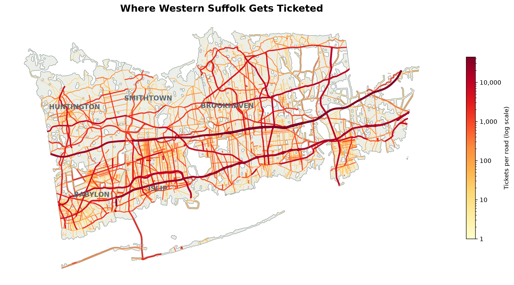

# Where Western Suffolk Gets Ticketed

Interactive maps and charts of traffic tickets in Babylon, Brookhaven, Huntington, Islip and Smithtown (Suffolk County, NY), January 2024 to October 2026.

**Live road map:** https://sambiblow.github.io/suffolk-ticket-map/suffolk_ticket_roads.html

**Live hour-by-day heatmap:** https://sambiblow.github.io/suffolk-ticket-map/ticket_heatmap.html

## Road map
- Every road with at least one ticket, colored yellow (few) to red (most) on a log scale
- A switch for all years, 2024, 2025 and 2026
- Stats for each period: busiest roads, busiest day and month, tickets per 1,000 residents by town

### How it works
1. Ticket locations are typed by hand, so each one is cleaned into a standard road name (removing direction notes, cross streets and house numbers, and combining spellings like "LIE", "I 495" and "W/B 495").
2. Census road lines are cut at town borders.
3. Each ticket is matched to a road with the same name in the same town. 95.6% of tickets were matched.

## Hour-by-day heatmap
- Shows when tickets are written: 24 hours by 7 days, shaded by share of tickets
- A dropdown to switch between violation types: speeding, signs and signals, phone and seat belt, paperwork, equipment and truck safety
- Each type is shown as a share of its own tickets, so patterns can be compared across types of different sizes

Key findings: weekday tickets peak from 8 to 11 a.m. and around 4 to 5 p.m. Speeding is the only type that peaks in the morning, and truck safety tickets are concentrated in a few weekday afternoon hours.

## Files
- `ticket_map.ipynb`: code for the road map
- `ticket_heatmap.ipynb`: code for the heatmap
- `suffolk_ticket_roads.html`, `ticket_heatmap.html`: the interactive charts
- `suffolk_ticket_roads.png`: static road map

## Data
- Ticket data: provided by the project sponsor (not included in this repo)
- Roads and town borders: U.S. Census Bureau TIGER/Line 2024

## Tools
Python (pandas, geopandas, matplotlib, folium, plotly)

Business Analytics Capstone, Farmingdale State College, Fall 2026
